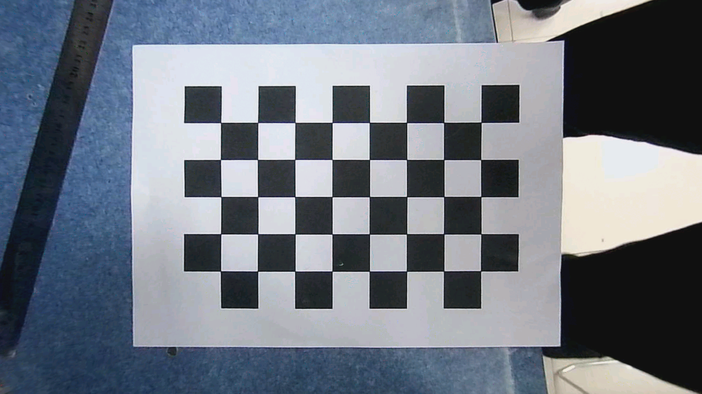

# 三轴R6上板验证（2026-10-31）

沿用已实拍验证的镜头参数，实际完成三轴平面逆透视与Brown畸变复合采样。真实相机为USB CAMERA、1920×1080 MJPG60；棋盘9×6方格，完整40内角点。检测点先做镜头逆畸变，再做PnP；最终FPGA从原始畸变图一次采样，避免串联两次重采样。

R6独立STA全部约束满足，最差setup **+0.199ns**，门限+0.197ns。JTAG SRAM下载PROGRAM_RESULT=0、DONE=1、CRC错误=0。位流SHA256：`A017344BB78CB5961D2F415C844ECBA80E4ED5B904AAB8EC9790A209873C5886`。APM 189/240、DRM 109.5/155，FF 46182、LUT29310，无新增整帧DDR池。

真实相机最终抓图：中心(960.059, 540.017)，距画面中心0.062px；水平残差-0.0097°；直线RMS 0.222px；方格横纵比例0.998498；整体仿射网格RMS 0.416px。该抓图是实际FPGA经PCIe取得，非软件矫正预览。

31个已知角度的完整硬件案例通过。最大中心误差0.170px，最大水平角误差0.0096°。生成棋盘含真实所用Brown畸变，并走真实HDMI/FPGA/PCIe，用于角度可控的功能验证。它不能代替手动快速转动时的运动模糊/端到端延迟验收。

| 横滚 / 俯仰 / 偏航 | FPGA输出fps中位数 | 5秒内采集FIFO溢出帧 |
|---|---:|---:|
| 0° / 0° / 0° | 59.6 | 0 |
| 8° / 0° / 0° | 57.6 | 0 |
| 15° / 0° / 0° | 55.1 | 0 |
| 0° / 20° / 0° | 60.1 | 0 |
| 0° / 0° / 20° | 59.1 | 0 |
| 12° / 10° / -10° | 56.1 | 0 |
| 45° / 0° / 0° | 30.0 | 75 |
| 90° / 0° / 0° | 20.0 | 101 |
| 0° / 0° / 0° | 60.1 | 0 |

性能表每行取5个约1秒区间。没有省略大角度采集FIFO溢出；fatal error_flags均为0不代表无采集丢帧。静态几何正确性与持续动态60fps是分别验证的指标。推荐小横滚工作，俯仰/偏航已知角度±20°案例接近60fps，组合(12°,10°,-10°)约56fps；全周横滚已验证代表点但未达到全周60fps。

原镜头量化11项（fx fy cx cy inv_fx inv_fy k1 k2 k3 p1 p2）为：
`[64143188,63959434,66399385,33939652,1097057,1100209,-25095,10013,-1857,18,-48]`。
实际板端回读与此相符；动态POSE v2只改9项H并保留这些Brown参数。H写地址0x340～0x360、能力版本3，与CAM3 DMA及旧控制器低9位地址译码隔离。

验证包括：83项Windows回归（82通过、1项POSIX测试跳过）；对应ARM持久SSH v2分包/握手/APPLIED测试单独通过；26项镜头/H参数原子跨时钟提交、实际CAM3+旧DMA控制器CSR隔离、DDR长停顿+镜像/无效射线黑块的RTL集成仿真通过；768组当前镜头定点坐标向量通过，浮点比较最大误差约0.074px。

当前完成的是基于棋盘平面的三轴基础版。尚未完成：实体IMU融合、不同深度场景的无视差稳定、相机曝光与参数逐帧配对、所有横滚角度60fps，以及快速运动残余抖动的量化验收。SSH与摄像头丢失时持有最后安全参数。

证据（docs/threeaxis-r6/）：known_angle_replay/hardware_results.json（11项）、known_angle_extended/hardware_results.json（20项）、known_angle_performance/performance_results.json及fpga_*.jsonl、threeaxis-r6/hardware_frames/*.json、coordinate_vectors、rtl_simulation、arm_v2_session_test.log。FPGA独立时序报告见../FPGA_AADCS/HDMI_Warp_3Axis/releases/r6-20261031/report_timing/hdmi_warp_top.rtr。

配套分支：ARM/上位机 https://github.com/Polaris-PT/RK3568-PCIE/tree/feat/three-axis-perspective-20261031 ；FPGA https://github.com/zyxw111/fpga-arbitrary-angle-distortion-correction/tree/feat/three-axis-perspective-20261031 。两个仓库的旧分支保持原状。

## ARM运行与持续抓图
板端先用sh tools/build_native.sh构建。tools/threeaxis/start_1080p60.sh与start_threeaxis_1080p60.sh是实测启动配置，默认路径分别为/userdata/fpga-view-live60-build与/userdata/checkerboard_60fps_20261031；部署到其他路径时须调整。三个DMA槽约12.4MB，板端CMA仅16MiB，建议保持单一显示进程，SIGTERM正常退出。Snapshot功能仅在设置FPGA_SNAPSHOT_PATH并发SIGUSR1时写一张已校验的帧；不会重复申请DMA。

ARM桥接部署：sh tools/install_pose_bridge_v2.sh /userdata/fpga-pose-ssh-v2。它安装host_ctl/arm_bridge中的规范源码，PC通过持久SSH执行pose_ssh_bridge_v2.py --require-lens-setup。旧2D位流会被H3D1版本3能力检查拒绝。

可复现RTL仿真：FPGA工程目录运行python tools/verify_three_axis_integration.py（需要numpy与Windows Icarus；IVERILOG_ROOT默认为D:/iverilog）。涵盖原子跨时钟提交、真实DMA CSR隔离、DDR停顿/镜像/背向射线及768组当前镜头定点向量。
